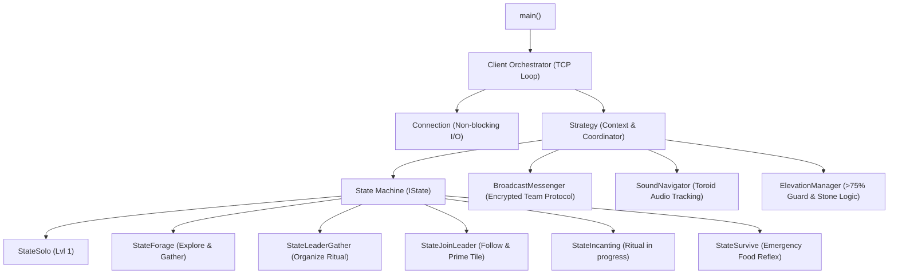
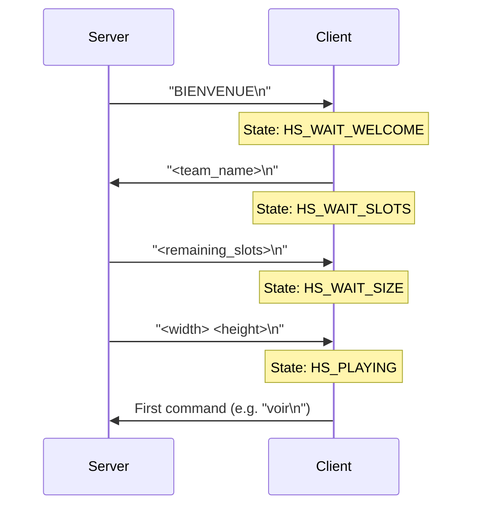
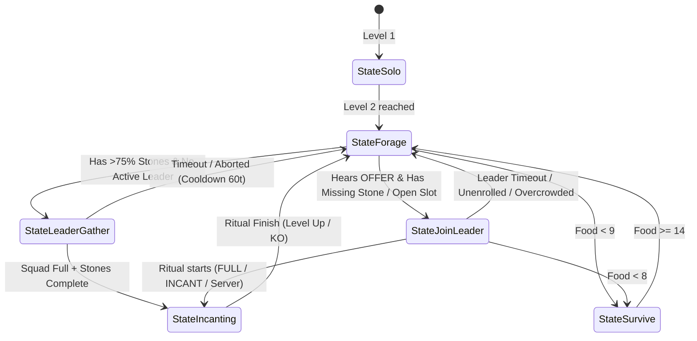

# Zappy Autonomous AI Client Documentation

## 1. Introduction & High-Level Architecture

The **Zappy AI Client** (`client/client`) is an autonomous agent written in C++ (C++11 standard). Multiple instances of this binary connect over TCP to the Zappy game server to form a cooperative team. 

In the Zappy game world:
- The world is a **toroid grid** (wrapping around edges horizontally and vertically).
- Every bot consumes **1 food unit every 126 ticks**. If food drops to zero, the bot starves and dies (`mort`).
- The world contains **food** and **6 rare minerals/stones**: `linemate`, `deraumere`, `sibur`, `mendiane`, `phiras`, and `thystame`.
- To level up (from Level 1 to the winning Level 8), players must conduct **elevation rituals** (incantations). Each level requires specific stones on the tile and an **exact number of players of the same level** present on that single tile.
- **Victory Condition**: 6 players from the same team reaching Level 8.

The AI client operates autonomously without central orchestration: every bot is an independent process running a deterministic event-driven state machine and coordinates with teammates solely using the in-game audio `broadcast` command.



---

## 2. Entry Point & Startup (`client/main.cpp`)

The executable begins execution in [`client/main.cpp`](main.cpp).

### Responsibilities:
1. **Command-Line Parsing**: Parses `-n <team>`, `-p <port>`, and optional `-h <host>` (defaulting to `127.0.0.1`).
2. **Signal Handling**: Catches `SIGINT` (Ctrl+C) to trigger graceful client shutdown (`Client::stop()`), and ignores `SIGPIPE` to prevent sudden termination when a socket resets.
3. **Instantiation & Execution**: Creates the `Client` object and invokes `client.run()`.

```cpp
// Snippet from client/main.cpp
int main(int ac, char **av)
{
    String team;
    String host = DEFAULT_HOST;
    int port = -1;

    for (int i = 1; i < ac; i++)
    {
        String arg = av[i];
        if (arg == "-n" && i + 1 < ac) team = av[++i];
        else if (arg == "-p" && i + 1 < ac) port = static_cast<int>(mzu::stringToInt(av[++i]));
        else if (arg == "-h" && i + 1 < ac) host = av[++i];
        else { printUsage(av[0]); return EXIT_FAILURE; }
    }
    if (team.empty() || port < 1 || port > 65535)
        return EXIT_FAILURE;

    signal(SIGINT, signalHandler);
    signal(SIGPIPE, SIG_IGN);

    try
    {
        Client client(team, host, port);
        client.run();
    }
    catch (std::exception &e)
    {
        mzu::terr(e.what());
        return EXIT_FAILURE;
    }
    return EXIT_SUCCESS;
}
```

---

## 3. Network Architecture & Handshake (`Client.cpp` & `Connection.cpp`)

The networking is managed by [`Client`](srcs/Game/Client.cpp) and [`Connection`](srcs/Network/Connection.cpp) using non-blocking BSD sockets and `select()`.

### The Handshake Sequence

When a TCP connection is established, the client and server exchange initial handshake tokens:



1. **`HS_WAIT_WELCOME`**: Upon connection, the server sends `BIENVENUE\n`. The client responds with its team name (`TeamRed\n`).
2. **`HS_WAIT_SLOTS`**: The server replies with an integer representing remaining open slots in this team. If `"ko"`, the team is unknown or full, and the client terminates.
3. **`HS_WAIT_SIZE`**: The server sends two integers: the map dimensions `<width> <height>` (e.g. `12 12`).
4. **`HS_PLAYING`**: The handshake completes; the bot enters the active game loop and immediately sends its first action (`sendNextCommand()`).

### Non-blocking Multiplexing Loop

The event loop in [`Client::run()`](srcs/Game/Client.cpp#L43-L95) uses `select()` with `readSet` and `writeSet`:

```cpp
// Snippet from client/srcs/Game/Client.cpp
void Client::run()
{
    __connection.connectTo(__host, __port);
    Client::up = true;

    while (Client::up && __state != HS_DEAD)
    {
        int sd = __connection.getSocket();
        fd_set readSet, writeSet;
        FD_ZERO(&readSet);
        FD_ZERO(&writeSet);
        FD_SET(sd, &readSet);
        if (__connection.hasPendingOutput())
            FD_SET(sd, &writeSet);

        struct timeval tv;
        tv.tv_sec = SELECT_TIMEOUT / 1000;
        tv.tv_usec = (SELECT_TIMEOUT % 1000) * 1000;

        int rv = select(sd + 1, &readSet, &writeSet, NULL, &tv);
        if (rv <= 0) continue;

        if (FD_ISSET(sd, &writeSet) && !__connection.writeSocket())
            break;
        if (FD_ISSET(sd, &readSet) && !__connection.readSocket())
            break;

        while (__connection.hasInboundLine())
        {
            String line = __connection.popInboundLine();
            if (__state == HS_PLAYING)
                handlePlayingLine(line);
            else if (__state == HS_WAIT_WELCOME)
                onWelcome(line);
            else if (__state == HS_WAIT_SLOTS)
                onSlots(line);
            else if (__state == HS_WAIT_SIZE)
                onSize(line);
        }
        if (__connection.hasPendingOutput() && !__connection.writeSocket())
            break;
    }
}
```

### Type-Safe Request/Reply Matching
To prevent packet desynchronization (where asynchronous broadcast messages or elevation notifications offset command replies):
- Unsolicited server messages (e.g., `message <dir>, <text>`, `elevation en cours`, `niveau actuel : K`) are intercepted without popping the in-flight command expectation.
- Action commands (`avance`, `droite`, `prend`, `pose`) expect `"ok"` or `"ko"`.
- Observation commands (`voir`, `inventaire`) parse bracketed strings `{...}`.

---

## 4. State Machine Architecture (`StrategyStates.cpp`)

The autonomous decision-making engine in [`Strategy`](srcs/Game/Strategy.cpp) implements the **State Pattern** via the [`IState`](srcs/Game/IState.hpp) interface.



### 1. `StateSolo` (Level 1)
- Level 1 requires only **1 linemate** and **1 player** (solo).
- The bot explores, picks up food and linemate, places the linemate, and casts `incantation` immediately without waiting for teammates.
- Upon reaching Level 2, transitions permanently to `StateForage`.

### 2. `StateForage` (Exploration & Resource Accumulation)
- **Occupied Tile Protection**: If `here.players > 1` and a leader is active or ritual ready, the foraging bot immediately executes `avance` to avoid disturbing active rituals.
- **Food Collection**: Maintains safe food reserves (`inv[NOURRITURE] < 45`).
- **Team Expansion (`fork`)**: Proactively lays eggs at Levels 1 and 2 when `food >= 14` to scale team size up to the 8-player cap early.
- **Stone Gathering**: Collects all stones found on tiles.
- **Leadership Candidacy**: If `!hasActiveLeaderForLevel(level)` and `ElevationManager::hasEnoughToLead(...)` passes (>75% stone threshold), the bot transitions to `StateLeaderGather` and assumes the leader role.
- **Wander Pattern**: 80% `avance`, 10% `droite`, 10% `gauche` to sweep across the toroid map.

### 3. `StateLeaderGather` (Ritual Coordination)
- **Tile Priming**: Deposits required stones from inventory onto the ground one by one.
- **Enrollment Broadcast**: Once stones are deposited, broadcasts `OFFER` containing remaining missing stones, available slots, and enrolled follower IDs.
- **Unresponsive Pruning**: Prunes followers who have not sent `HERE` within 40 ticks so other nearby teammates can fill their spots.
- **Firing Incantation**: When `here.players == targetPlayers` and `stonesComplete`, broadcasts `FULL` and queues `incantation`.
- **Abort Guard**: If gathering takes > 120 ticks, broadcasts `ABORT`, sets a 60-tick gather cooldown, and returns to foraging.

### 4. `StateJoinLeader` (Follower Transit & Assembly)
- **Sound Navigation**: Follows directional audio pulses (directions 1–8) toward the leader using [`SoundNavigator`](srcs/Game/SoundNavigator.cpp).
- **Slot Reservation (`JOIN`)**: Sends `JOIN` upon receiving `OFFER`. If the leader broadcasts `slotsNeeded == 0` and the bot's ID is not in `enrolledIds`, the follower aborts back to `StateForage`.
- **Tile Arrival**:
  - Deposits missing stones onto the tile first to prime it.
  - Broadcasts `HERE` every 2 ticks to confirm presence on the tile.
- **Overcrowding Guard**: If `here.players > targetPlayers` or `!isEnrolled()`, steps off the tile (`avance`) to maintain the exact player count required by the server.

### 5. `StateIncanting` (Ritual Wait)
- Incantations take **300 server ticks**.
- The bot freezes on the tile and monitors for `niveau actuel : K` (success) or `ko` (failure).
- If 320 ticks pass without a server reply, a timeout safety resets the bot back to `StateForage`.

### 6. `StateSurvive` (Emergency Food Reflex)
- Triggered if food drops below 9.
- Bypasses stone gathering to sprint exclusively toward food visible in front of the bot.

---

## 5. Inter-Bot Broadcast Protocol (`BroadcastMessenger.cpp`)

Bots communicate over distance using the server's `broadcast <text>` command. The server translates this into an audio direction relative to each receiver: `message <direction>, <text>`.

### Team Encryption & Secret Hash
To prevent adversarial injection or cross-team confusion, every broadcast begins with a 5-digit hash computed deterministically from the team name:

```cpp
// Snippet from client/srcs/Game/BroadcastMessenger.cpp
int BroadcastMessenger::computeHash(const String &team) const
{
    if (team.empty()) return 0;
    long long hash = 42;
    for (size_t i = 0; i < team.size(); i++)
        hash = (hash * 31 + static_cast<unsigned char>(team[i])) ^ 0x5F37;
    return static_cast<int>(std::abs(hash % 90000) + 10000);
}
```

Every incoming message is validated against `__secretHash`. Foreign broadcasts are discarded immediately.

### Protocol Specification

| Command | Format | Sender | Description |
| :--- | :--- | :--- | :--- |
| `OFFER` | `ZAP <hash> <myId> OFFER <lvl> <slots> <s1>..<s6> [ids..]` | Leader | Announces ritual level, open slots, missing stones on tile, and list of enrolled follower IDs |
| `JOIN` | `ZAP <hash> <myId> JOIN <lvl> <leaderId>` | Follower | Requests slot reservation in leader's ritual squad |
| `HERE` | `ZAP <hash> <myId> HERE <lvl> <leaderId>` | Follower | Confirms follower has arrived physically on the leader's tile |
| `FULL` | `ZAP <hash> <myId> FULL <lvl>` | Leader | Signals squad is full and incantation is imminent; followers hold position |
| `INCANT` | `ZAP <hash> <myId> INCANT <lvl>` | Leader | Signals incantation command was issued |
| `ABORT` | `ZAP <hash> <myId> ABORT <lvl>` | Leader | Cancels gather; releases enrolled teammates back to foraging |
| `EGG` | `ZAP <hash> <myId> EGG 0` | Any | Informs team that an egg was laid; increments team population estimate |

#### Example: `OFFER` Payload
```
ZAP 25593 104521 OFFER 4 1 0 0 1 0 0 0 304812 510922
 │    │      │     │   │ │ │ │ │ │ │ │    │      └── Enrolled Follower ID #2
 │    │      │     │   │ │ │ │ │ │ │ │    └───────── Enrolled Follower ID #1
 │    │      │     │   │ └─┴─┴─┴─┴─┴─┴────────────── Missing stones on tile (1 sibur missing)
 │    │      │     │   └──────────────────────────── Slots still needed: 1
 │    │      │     └──────────────────────────────── Target level: 4 (needs 4 players)
 │    │      └────────────────────────────────────── Action: OFFER
 │    └───────────────────────────────────────────── Leader ID: 104521
 └────────────────────────────────────────────────── Secret Team Hash
```

---

## 6. Squad Enrollment & >75% Stones Prerequisite

To prevent deadlocks and infinite gather-abort loops, two critical algorithms were introduced:

### 1. The >75% Stone Threshold (`ElevationManager.cpp`)

Leaders are forbidden from declaring leadership unless they hold **more than 75% of the total stones** required for that level:

```cpp
// Snippet from client/srcs/Game/ElevationManager.cpp
bool ElevationManager::hasEnoughToLead(int currentLevel, const int inventory[RESOURCE_COUNT])
{
    if (currentLevel < 1 || currentLevel >= WIN_LEVEL)
        return false;
    const s_elevation_req &req = Elevation::getRequirement(currentLevel);
    int totalNeeded = 0, totalPresent = 0;

    for (size_t i = 0; i < ALL_STONES_COUNT; i++)
    {
        e_resource res = ALL_STONES[i];
        int needed = Elevation::requiredAmount(req, res);
        totalNeeded += needed;
        totalPresent += std::min(inventory[res], needed);
    }
    if (totalNeeded <= 0) return false;

    // Strict >75% stone threshold
    double stoneRatio = static_cast<double>(totalPresent) / static_cast<double>(totalNeeded);
    if (stoneRatio <= 0.75)
        return false;

    // Rare stone prerequisites
    if (currentLevel == 3 && (inventory[SIBUR] < 1 || inventory[PHIRAS] < 1)) return false;
    if (currentLevel == 4 && (inventory[SIBUR] < 1 || inventory[PHIRAS] < 1)) return false;
    if (currentLevel == 5 && inventory[MENDIANE] < 2) return false;
    if (currentLevel == 6 && (inventory[SIBUR] < 2 || inventory[PHIRAS] < 1)) return false;
    if (currentLevel == 7 && inventory[THYSTAME] < 1) return false;

    return true;
}
```

- **Level 2 (3 stones needed)**: 100% required (3/3 stones).
- **Level 3 & 4 (5 stones needed)**: 80% required (4/5 stones).
- **Level 5 & 6 (7 stones needed)**: 85.7% required (6/7 stones).
- **Level 7 (11 stones needed)**: 81.8% required (9/11 stones, must include `thystame`).

### 2. Multi-bot Squad Enrollment (`JOIN` / `enrolledIds`)

Prior to enrollment, every teammate rushed to a leader upon hearing `OFFER`, resulting in 5–6 bots crowding a 2- or 4-player ritual tile. The server strictly rejects incantations if extra players are on the tile (`sameLevelCount != req.players_needed` or `tile.getPlayerIds().size() != req.players_needed`).

1. **Follower joins only if eligible**:
   - If stones are missing on the leader tile, the follower only joins if it carries at least one of those missing stones in its inventory.
   - If stones on the tile are already complete, any teammate of that level can join to fill the player count quota.
2. **Leader slot allocation**:
   - Follower broadcasts `JOIN`.
   - Leader receives `JOIN` and adds the follower ID to `__enrolledFollowers` (up to `targetPlayers - 1`).
   - Leader broadcasts enrolled IDs in `OFFER`.
3. **Follower filter**:
   - When a follower sees `slotsNeeded == 0` and its ID is not enrolled, it returns to `StateForage`.
   - Any extraneous or unenrolled bot standing on the leader tile executes `avance` to step off immediately.

---

## 7. Toroid Sound Navigation (`SoundNavigator.cpp`)

When a player receives `message <direction>, <text>`, direction values 1–8 represent the sound's arrival angle relative to the player's current orientation:

```
        8   1   2
          \ | /
        7 - P - 3
          / | \
        6   5   4
```

[`SoundNavigator::stepSoundDirection`](srcs/Game/SoundNavigator.cpp#L12) executes the optimal movement to step toward the sound:
- **Direction 0**: Emitter is on the same tile (arrived).
- **Direction 1**: Forward corridor $\rightarrow$ sends `avance`.
- **Direction 2**: Forward-right $\rightarrow$ `avance`, then faces right.
- **Direction 3**: Exact right $\rightarrow$ `droite`, then queues `avance`.
- **Direction 4**: Rear-right $\rightarrow$ `droite`, `droite`, `avance`.
- **Direction 5**: Directly behind $\rightarrow$ `droite`, `droite`, `avance`.
- **Direction 6**: Rear-left $\rightarrow$ `gauche`, `gauche`, `avance`.
- **Direction 7**: Exact left $\rightarrow$ `gauche`, then queues `avance`.
- **Direction 8**: Forward-left $\rightarrow$ `avance`, then faces left.

---

## 8. Complete End-to-End Elevation Cycle

```mermaid
sequenceDiagram
    autonumber
    participant L as Leader Bot (Id 100)
    participant F as Follower Bot (Id 200)
    participant S as Zappy Server

    Note over L: StateForage: holds >75% stones
    L->>L: Transition to StateLeaderGather
    L->>S: "pose linemate\n"
    S-->>L: "ok\n"
    L->>S: "pose sibur\n"
    S-->>L: "ok\n"
    Note over L: Stones on tile deposited; missing: 1 phiras
    L->>S: "broadcast ZAP <hash> 100 OFFER 3 1 0 0 0 0 1 0\n"
    S-->>F: "message 3, ZAP <hash> 100 OFFER 3 1 0 0 0 0 1 0\n"
    Note over F: Carries phiras! Eligible to help.
    F->>L: "broadcast ZAP <hash> 200 JOIN 3 100\n"
    L->>L: Enrolls Bot 200 in squad (slotsNeeded = 0)
    L->>S: "broadcast ZAP <hash> 100 OFFER 3 0 0 0 0 0 1 0 200\n"
    S-->>F: "message 1, ZAP <hash> 100 OFFER 3 0 0 0 0 0 1 0 200\n"
    Note over F: Enrolled! Follows sound to direction 1
    F->>S: "avance\n"
    S-->>F: "ok\n"
    Note over F: Arrived on leader tile (dir = 0)
    F->>S: "pose phiras\n"
    S-->>F: "ok\n"
    F->>S: "broadcast ZAP <hash> 200 HERE 3 100\n"
    Note over L: Tile stones complete & exactly 2 players present
    L->>S: "broadcast ZAP <hash> 100 FULL 3\n"
    L->>S: "incantation\n"
    S-->>L: "elevation en cours\n"
    S-->>F: "elevation en cours\n"
    Note over L,F: StateIncanting (300 ticks)
    S-->>L: "niveau actuel : 4\n"
    S-->>F: "niveau actuel : 4\n"
    Note over L,F: LEVEL UP! Transition to StateForage
```

---

## 9. Elevation Requirements Reference

| Level Transition | Players Needed | Linemate | Deraumere | Sibur | Mendiane | Phiras | Thystame | Total Stones |
| :---: | :---: | :---: | :---: | :---: | :---: | :---: | :---: | :---: |
| **1 $\rightarrow$ 2** | 1 (Solo) | 1 | 0 | 0 | 0 | 0 | 0 | 1 |
| **2 $\rightarrow$ 3** | 2 | 1 | 1 | 1 | 0 | 0 | 0 | 3 |
| **3 $\rightarrow$ 4** | 2 | 2 | 0 | 1 | 0 | 2 | 0 | 5 |
| **4 $\rightarrow$ 5** | 4 | 1 | 1 | 2 | 0 | 1 | 0 | 5 |
| **5 $\rightarrow$ 6** | 4 | 1 | 2 | 1 | 3 | 0 | 0 | 7 |
| **6 $\rightarrow$ 7** | 6 | 1 | 2 | 3 | 0 | 1 | 0 | 7 |
| **7 $\rightarrow$ 8** | 6 | 2 | 2 | 2 | 2 | 2 | 1 | 11 |

---

## 10. Building and Running

From the root repository directory:

```bash
# Clean previous build artifacts
make fclean

# Build all three components (server, client, gfx)
make

# Launch simulation with 2 teams on a 12x12 map
./run_zappy.sh
```
